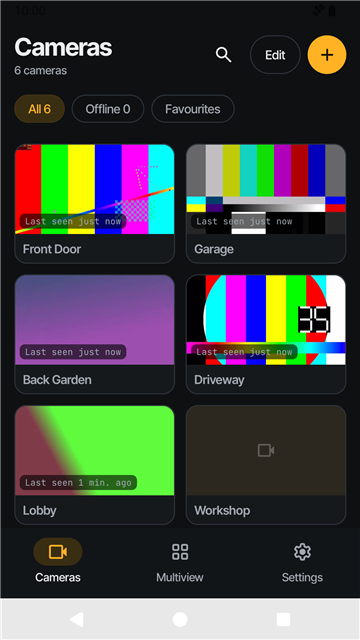
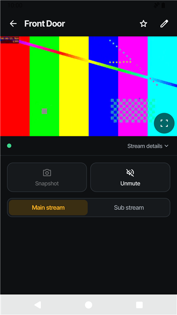
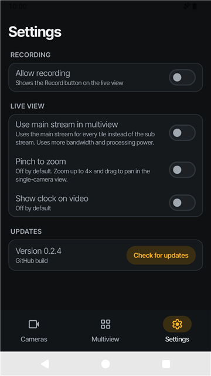
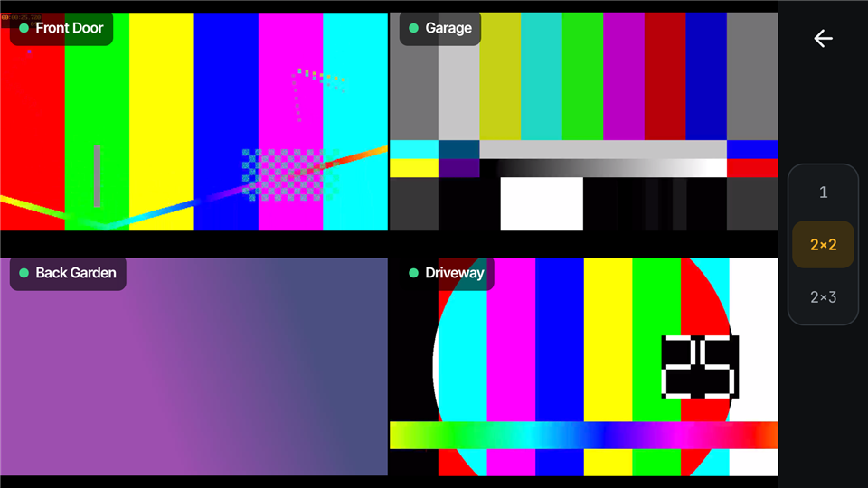

  

<h1 align="center">RTSP</h1>

A fast, private Android viewer for your own RTSP cameras.

  
  
  

  

- **Camera list**: every camera with its last snapshot and a last-seen time.
- **Live view**: one camera with a main and sub stream toggle, mute, fullscreen, picture-in-picture and live snapshots.
- **Multiview**: several cameras on screen at once.
- **Settings**: playback options, defaults for new camera streams and update checks.

## Features

- Add any `rtsp://` endpoint with optional sub stream URL, username and password
- Passwords are encrypted on the device with the Android Keystore
- TCP, UDP or automatic transport and adjustable latency
- Automatic reconnect with backoff
- Frozen-video detection based on advancing rendered frames
- Test connections before saving, with authentication and stream-path errors
- Camera connection status with retry and periodic checks while the camera list is open
- Stream details with resolution, frame rate, codec, video bitrate and negotiated TCP/UDP transport
- Fullscreen live view rotates to landscape and restores the previous orientation on exit
- Save and share a snapshot from the current live frame, including in fullscreen
- Picture-in-picture for a single live camera, with the stream continuing while another app is open
- Default transport, latency buffer and muted state for newly added cameras
- Multiview grids of 1, 2x2 or 2x3 using sub streams to save bandwidth
- Favourites, search and last-seen snapshots
- Optional image preview refresh every 15 seconds for visible cameras in the camera list
- Choose Viewfinder, Tally lens, Stream lens or Quad view under Settings → App icon, with themed icons on Android 13+
- No accounts and no cloud service

## Install

Download the latest APK from [GitHub Releases](https://github.com/aaronburt/rtsp/releases/latest) and install it. Requires Android 8.0 or newer. The app checks GitHub Releases for new versions and can download and install updates itself.

## Google Play Protect warning

Since 0.7.x, Google Play Protect may show "Harmful app blocked" or "This app may be harmful" when you install the APK. This is believed to be a false positive. Nothing that Play Protect typically flags has changed since 0.6.0: the permissions, the dependencies and the signing key are the same. The app is a small open-source viewer with no accounts and no cloud service, and Play Protect often flags new or rarely installed sideloaded APKs that it has not seen before.

If you are comfortable with it, tap **More details** and then **Install anyway**. If you would rather check first:

- **VirusTotal scan**: results for each release are also linked from its release notes.
  <!-- virustotal-start -->
  _VirusTotal link for the latest release will be added here automatically._
  <!-- virustotal-end -->
- **Signing certificate**: check that the APK is signed by the same key as every other release with `apksigner verify --print-certs app-github-universal-release.apk` and compare the SHA-256 digest with the one published on the release page. The same key signs updates, and Android refuses to install an update signed with a different one.
- **Build from source**: the code is all in this repository. Run `./gradlew assembleGithubRelease` (or `assembleFdroidRelease`) and install the result yourself. See the [workflow](.github/workflows/release.yml) for how releases are built.

## Licence

Apache License 2.0. See [LICENSE](LICENSE).
